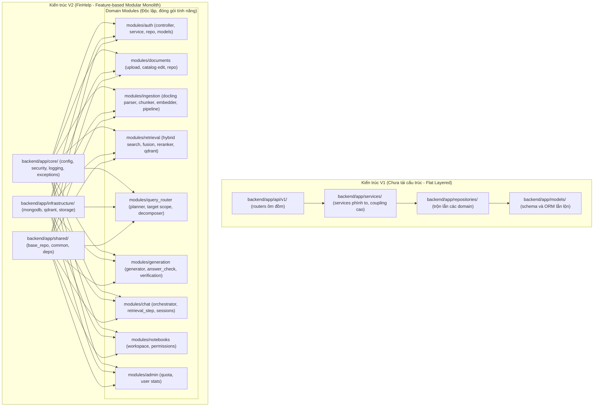

# FinHelp: Kế hoạch Phát triển & Lộ trình Hoàn thiện V2 (Dev Roadmap V2)

> **Tài liệu chiến lược & Lộ trình kỹ thuật chính thức**  
> **Dự án tốt nghiệp:** Hệ thống Trợ lý AI Phân tích & Tra cứu Báo cáo Tài chính có Kiểm chứng Số liệu (**FinHelp**)  
> **Sinh viên thực hiện:** Vũ Thành (MSSV: 20225405) - Trường CNTT & TT, ĐHBK Hà Nội (HUST)  
> **Cập nhật ngày:** 13/11/2026 (lần 2, sau khi gộp nhánh và làm xong F9). Trạng thái trong bảng mục 1 đã được **đối chiếu với code và git** ngày này. Bản trước: 07/11/2026.  
> **Trạng thái quy ước:** ✅ Đã hoàn thành · 🚧 Đang triển khai · ⬜ Chưa triển khai · ↪ Đã đổi hướng

Ghi chú về dòng "Sinh viên thực hiện": bản 07/11 ghi tên và mã số của tác giả một đồ án khác (đã được nêu trong `Version_3/PROJECT_PLAN.md`). Bản này sửa theo `docs/new_ideas.md` và tên tài khoản git; sinh viên đã xác nhận ngày 13/11/2026.

Tài liệu liên quan:
- [Version_3/PROJECT_PLAN.md](../Version_3/PROJECT_PLAN.md): kế hoạch tổng thể ngày 09/11 (các giai đoạn 0–6, thiết kế Agentic RAG).
- [Version_3/plan_p0_tests.md](../Version_3/plan_p0_tests.md): bộ test P0, nhật ký thực hiện.
- [Version_3/report_p0_suite_2026-11-13.md](../Version_3/report_p0_suite_2026-11-13.md): bảng điểm P0 và danh sách việc cần sửa.
- [ARCHITECTURE.md](../../ARCHITECTURE.md): kiến trúc đúng với code.

---

## 1. Tổng quan Tiến độ Thực hiện (Progress Tracker)

| Mã | Hạng mục công việc | Trạng thái | Bằng chứng (đối chiếu 13/11) và việc còn lại |
|---|---|---|---|
| **F-1** | Chuẩn hóa `.env.example` & dọn dẹp schema rác | ✅ 2026-10-28 | Không đổi. |
| **F0** | Nhánh git an toàn & hạ tầng | ✅ 2026-11-07 | Docker Compose: MongoDB 7.0, Qdrant **v1.19.2** (bản trước ghi nhầm v1.12). |
| **F1** | Tái cấu trúc Backend Modular Monolith | ✅ 2026-11-07 | Hiện có **740 test** trong `backend/tests/` (lúc tái cấu trúc: 199). |
| **F2** | Chuyển bộ đánh giá sang `backend/evaluation/` | ⬜ | Thư mục `backend/evaluation/` **chưa tồn tại**. Mọi bộ đo vẫn nằm trong `experiments/` (bị git bỏ qua), nên số liệu báo cáo chưa tái lập được từ repo. |
| **F3** | Frontend Router, Landing Page, Multi-Notebook Hub | ✅ | `react-router-dom` đã cài, có `features/landing`, `features/workspace`. TanStack Query: ↪ đã quyết không làm trước bảo vệ (PROJECT_PLAN). |
| **F3.5** | Schema MongoDB V3.1 | 🚧 | Có `scripts/migrate_mongo_v3.py` và `tests/test_mongo_v3.py`. **Chưa xác minh** trong lần đối chiếu này việc migration đã chạy trên cơ sở dữ liệu thật. |
| **F4** | Hội thoại: `focus_state`, câu nối tiếp, báo câu trả lời sai | ✅ | `query_router/focus.py`, `test_conversation_focus.py`, bộ 30 đoạn hội thoại; ca P0 F01 đạt. Báo sai số liệu: `user_rating = -1`. Nhánh `feat/f4-conversation` đã **gộp vào `main` cục bộ ngày 13/11** (commit `4f5a9ec`, 7 commit sau PR #8; 740 test qua), **chưa đẩy `main` lên GitHub**. Chưa làm: gợi ý câu hỏi tiếp theo sinh theo chỉ tiêu (hiện là 3 gợi ý cố định). Cây tin nhắn `parent_message_id`: ↪ không làm (trái với "1 notebook = 1 chat"). |
| **F5** | SSE Streaming và tiến trình | ✅ | Route `POST /chat/query/stream`, `chat/events.py` (commit `1042522`). |
| **F6** | Redis + `arq` worker | ↪ | Không có Redis hay `arq` trong `requirements.txt` và `docker-compose.yml`. PROJECT_PLAN đã quyết giữ job trong MongoDB. Giới hạn tần suất đang lưu trong bộ nhớ của một tiến trình (`shared/rate_limit.py`). |
| **F7** | Email OTP (SendGrid) | ✅ | `/auth/forgot-password`, `/auth/reset-password`; cơ sở dữ liệu chỉ giữ mã băm của OTP. Không chạy thử lại trong lần đối chiếu này. |
| **F8** | Cloudflare R2 | ✅ | `STORAGE_BACKEND = "local" \| "r2"`, `boto3`, `scripts/test_r2_connection.py`. Không chạy thử lại trong lần đối chiếu này. |
| **F9** | PDF Viewer tô sáng trích dẫn | ✅ 2026-11-13 (commit `10422a0` trên nhánh `feat/f9-pdf-highlight`, chưa gộp vào `main`) | Bấm trích dẫn thì nhảy tới trang **và tô vàng đúng các dòng của đoạn trích** trên trang. Cách làm: đọc chữ của trang bằng pdf.js (`getTextContent`), cắt đoạn trích và chữ trang thành từ và số, tìm cửa sổ chữ khớp nhất cho từng dòng của đoạn trích (số có trọng số cao hơn từ), rồi gộp các ô cùng một dòng thành một dải (`locateExcerpt.ts`). Đo trên 27 trang bảng thật của 10 báo cáo: **303/304 dòng được tìm thấy (99,7%)**; dòng có con số bị tìm nhầm sang trang khác 6,5%. Xem trên trình duyệt 3 PDF (Coca-Cola, AES, Netflix): dải tô nằm đúng dòng, bám theo khi phóng to, mất khi sang trang khác, hiện lại khi quay về. Giới hạn: trang quét ảnh (không có chữ) hoặc xoay ngang thì không tô được, banner báo rõ và vẫn nhảy tới trang; chưa thử với tài liệu tiếng Việt. Chạy lại bài đo: `npm run test:highlight` trong `frontend/`. |
| **F10** | Admin Portal | ✅ | Commit `2fb1cd9`: `modules/admin/overview.py`, `frontend/src/features/admin/` (Overview, Documents, Audit, Tokens, Users). |
| **F11** | Observability, Dockerization, CI/CD | ⬜ | Có `backend/Dockerfile`, `frontend/Dockerfile`; `/health` đã thử kết nối thật (trả 503 khi hỏng). **Chưa có** `.github/workflows/`, `README.md`, `frontend/nginx.conf`. |
| **F12** | Chuẩn bị bảo vệ | ⬜ | Dự kiến 10/12. |

### Hạng mục phát sinh sau 07/11 (không có trong bản trước)

| Mã | Hạng mục | Trạng thái | Ghi chú |
|---|---|---|---|
| **G1** | Lớp guard: gắn một nhãn an toàn cho mỗi tin nhắn | ✅ | Commit `a0ca4b5`; bộ đo 363 ca trong `experiments/guardrail_eval/`. |
| **G2** | Kiểm chứng câu trả lời: sửa phép tính bằng code, kiểm từng con số với đoạn trích | ✅ | Commit `93ad4ee`, `922d38f`. |
| **G3** | Lưới an toàn (safety net) cho câu hỏi nhiều tài liệu, lưới sau câu trả lời | ✅ | Commit `3ef849b`. |
| **P0** | Bộ test hành vi P0 từ `tối ưu.txt` (P0 = nhóm ưu tiên cao nhất trong file đó: những hành vi phải đúng trước khi ra bản MVP; P1, P2 là nhóm sau) | ✅ (trừ 1 ca chờ GPU) | 22 ca, ba mức chạy. Kết quả ở mục 5. Chưa đưa vào `backend/tests/` (sinh viên: chưa làm vội). |

---

## 2. So sánh Kiến trúc V1 (Cũ) và V2 (Mới sau Tái cấu trúc)

---

## 3. Bản đồ Thiết kế Hệ thống trong Thư mục `docs/Version_2/`

Toàn bộ tài liệu phân tích thiết kế, use case và sơ đồ quy trình được tổ chức khoa học theo đúng chuẩn đề cương đồ án tốt nghiệp ĐHBK Hà Nội:

1. **Kiến trúc & Sơ đồ Tổng thể (`docs/Version_2/diagrams/`):**
   - `overview_usecase.mermaid`: Biểu đồ Use Case tổng quan toàn bộ hệ thống FinHelp (Actor: User, Admin, Support Specialist, System).
   - `system_architecture.mermaid`: Sơ đồ kiến trúc phân tầng Modular Monolith và luồng dữ liệu 4 Zone.
   - `rag_pipeline_e2e.mermaid`: Sơ đồ pipeline RAG E2E kết hợp Dense + Sparse + Qwen Reranker + Verification.
   - `database_erd.mermaid`: Sơ đồ thực thể liên kết ERD giữa MongoDB (metadata, chat, catalog) và Qdrant (vectors).
   - `diagrams_viewer.html`: Trang web hiển thị trực quan toàn bộ sơ đồ có thể zoom, xuất ảnh và thuyết trình.

2. **Chi tiết Từng Phân hệ Chức năng (`docs/Version_2/use_cases/`):**
   - `01_authentication_and_user/`: Đặc tả UC Đăng ký, Đăng nhập JWT, Quản lý tài khoản và Phân quyền Role.
   - `02_document_ingestion_and_catalog/`: Đặc tả UC Upload BCTC PDF, Bóc tách Docling, Xác nhận kỳ báo cáo/Ticker và Embedding BGE-M3.
   - `03_chat_and_rag_query/`: Đặc tả UC Truy vấn ngôn ngữ tự nhiên, Định tuyến câu hỏi đơn/đa tài liệu, Hybrid Search RRF và Rerank.
   - `04_citation_and_numerical_verification/`: Đặc tả UC Bóc tách trích dẫn trang BCTC, Kiểm tra độ chính xác số học (`answer_check/`) và Nhảy Split-View.
   - `05_workspace_and_notebooks/`: Đặc tả UC Quản lý Notebook cá nhân, Nhóm tài liệu theo danh mục đầu tư, Lịch sử trò chuyện.
   - `06_admin_and_monitoring/`: Đặc tả UC Giám sát hạn mức người dùng, Quản trị kho tài liệu công khai và Nhật ký kiểm toán.

Lưu ý: các sơ đồ này vẽ theo trạng thái 07/11 và chưa có lớp guard, luồng SSE và trang admin. Sơ đồ đúng với code hiện tại nằm trong `ARCHITECTURE.md` (mục 1).

---

## 4. Việc đã làm ngày 13/11: bộ test P0

Bối cảnh: câu hỏi "hệ thống giống NotebookLM nhưng kém hơn, có nên chuyển sang agent với LangGraph và thêm kho tri thức tài chính". Trước khi đổi kiến trúc, 18 hành vi bắt buộc (P0) của `tối ưu.txt` được viết thành ca kiểm thử và chạy trên code hiện tại. Chi tiết từng bước, từng thay đổi và lý do: [plan_p0_tests.md](../Version_3/plan_p0_tests.md).

| Mức | Chạy gì | Kết quả |
|---|---|---|
| L0: hàm thuần của backend | 10 ca | 8 đạt, 2 trượt |
| L1: orchestrator thật, mô hình và tìm kiếm giả | 10 ca | 5 đạt, 4 trượt, 1 không áp dụng |
| L2: câu trả lời do DeepSeek thật viết, đoạn trích bịa | 10 ca, 11 lần gọi | 8 đạt, 1 đạt yếu, 1 lưng chừng |
| Tìm trên PDF thật (ca D03) | 1 ca | **Chưa chạy**: chờ địa chỉ GPU worker |

Không file nào trong `backend/` hay `frontend/` bị sửa khi làm bộ test. Mã và kết quả ở `experiments/p0_suite/`.

### Cùng ngày, sau quyết định của sinh viên

1. **Gộp `feat/f4-conversation` vào `main`.** Làm trong một thư mục git tạm (không đụng thư mục làm việc đang có thay đổi chưa commit). `origin/main` đã có PR #8, nên còn 7 commit chưa vào (bản trước ghi 10 vì so với `main` cục bộ đã cũ). Không xung đột; cây thư mục sau gộp **giống hệt** đầu nhánh; `pytest` 740 qua. Commit gộp `4f5a9ec`. **Chưa đẩy `main` lên GitHub** (máy không có `gh`, và đẩy là việc cần bạn đồng ý). Ghi chú: nhánh này đã đưa file build `frontend/tsconfig.tsbuildinfo` vào git; nên bỏ khỏi git.
2. **F9 tô sáng trích dẫn trên PDF**: xem dòng F9 ở mục 1. File mới: `frontend/src/components/notebook/locateExcerpt.ts` (hàm thuần), `frontend/scripts/test-highlight.mjs`; sửa `SourceViewer.tsx`, `notebook.css`, ba file `locales/`, `package.json`. `tsc` và `vite build` qua. Không cần backend, GPU hay API: đoạn trích (`snippet`) đã có sẵn trong mỗi trích dẫn.

---

## 5. Điều bảng điểm P0 cho thấy

1. **Chỗ thiếu nằm trước mô hình ngôn ngữ.** Với đoạn trích gọn, mô hình thật tự nói "không có trong đoạn trích", không bịa số, nêu cả hai giá trị khi thấy cả hai, không theo lệnh ẩn trong PDF. Các ca trượt đều là chuyện **cái gì tới được mô hình**.
2. **Hệ thống biết một tài liệu rỗng, chưa biết một mục thiếu.** Tìm kiếm vector luôn trả về cái gì đó, nên ghi chú "không tìm thấy đoạn nào" gần như không bao giờ kích hoạt (ca D07, G02). Đây chính là bước "Grader" còn thiếu đã ghi trong PROJECT_PLAN ngày 09/11.
3. **Số liệu đã điều chỉnh bị che.** Hỏi một năm chỉ có ở cột so sánh, hệ thống chỉ tìm trong một báo cáo sớm nhất (ca G04).
4. **Máy tính chỉ tiêu sửa số học, không sửa công thức** (ca E03w; E01: mô hình gọi tổng tài sản cuối kỳ là công thức ROA "chuẩn").
5. **Tìm kiếm hết giờ thì không thử lại**, người dùng nhận lỗi chung `INTERNAL_ERROR` (ca J03).
6. **Câu đơn giản không bị làm quá**: 2 lần gọi mô hình, 1 lượt tìm (ca K01). Kiểm soát truy cập, khớp tên công ty, câu nối tiếp, căn chỉnh năm tài chính đều đạt.

---

## 6. Các quyết định

Ghi theo trả lời của sinh viên ngày 13/11.

| # | Quyết định | Trạng thái |
|---|---|---|
| 1 | **LangGraph hay vòng lặp viết tay** | **Chưa chốt.** Sinh viên hỏi LangGraph có dễ xem và hiểu luồng hơn không. Trả lời: có một phần, chủ yếu là cách trình bày (sơ đồ sinh tự động từ code, mỗi bước là một nút có tên, test từng nút). Phần "dễ hiểu" đó cũng làm được bằng cách tách `orchestrator.py` (khoảng 660 dòng) thành các hàm bước có tên và vẽ sơ đồ từ code, vì `ARCHITECTURE.md` và sơ đồ archify đã cho thấy luồng. LangGraph không làm logic đơn giản hơn, thêm một thư viện cần gỡ lỗi, và sự kiện tiến trình đã có (`chat/events.py`). Đề xuất giữ nguyên: viết vòng lặp B2 bằng code thường, đo, rồi bọc bằng LangGraph nếu cần cho đồ án. |
| 2 | **Câu hỏi khái niệm tài chính trả lời từ kho tri thức** | **Chưa quyết**, nghiêng về có (khoảng 70% có, 30% không). Kho tri thức chưa làm, nên chưa cần đổi chính sách `refuse_concept` lúc này. |
| 3 | **`docs/Version_3/` và `experiments/p0_suite/` có bỏ khỏi danh sách git bỏ qua không** | **Không bỏ.** Các file đó tiếp tục chỉ ở trên máy này. (Riêng `docs/Version_2/` đã được git theo dõi.) |
| 4 | **Gộp `feat/f4-conversation` vào `main`** | **Đã gộp cục bộ**, chưa đẩy lên GitHub (mục 4). |
| 5 | **Đưa ca P0 vào `backend/tests/`** | **Chưa làm vội.** |
| 6 | **Tô sáng trích dẫn trên PDF (F9)** | **Đã làm xong** (mục 1). |
| 7 | **Bản quyền giáo trình CFA** | Chưa quyết, chỉ cần khi có kho tri thức. Đề xuất: dùng trong đồ án và demo nội bộ, không phát hành công khai kèm nội dung. |

**Quy ước tạm thời:** việc cần địa chỉ GPU (tunnel) hoặc gọi API trả tiền được để sau, vì hết hạn mức Kaggle. Chúng được gắn nhãn ⏸ ở mục 7.

---

## 7. Các bước tiếp theo (từ 14/11 đến 10/12)

Thứ tự theo giá trị với mục tiêu "khác NotebookLM ở chỗ số liệu đáng tin và phân tích tài chính được". Ngày là ước lượng; mỗi đợt dừng báo cáo trước khi sang đợt sau. Mọi sửa trong `backend/` cần duyệt; mọi lần gọi mô hình trả tiền cần lời đồng ý kèm số lần gọi. Việc cần **tunnel GPU hoặc API** gắn ⏸ và để sau (hết hạn mức Kaggle).

### Việc làm ngay được: không cần GPU, không gọi API

**Đợt A (14–15/11): dọn sau đợt vừa rồi**
- [x] Commit F9 (`10422a0`). Còn: quyết định đẩy `main` và nhánh `feat/f9-pdf-highlight` lên GitHub, và gộp nhánh F9 vào `main`.
- [ ] Bỏ `frontend/tsconfig.tsbuildinfo` khỏi git và thêm vào `.gitignore` (file build bị commit nhầm).
- [ ] Chạy thử F9 trong ứng dụng thật với PDF tải lên (cần Mongo và backend đang chạy; lần kiểm vừa rồi dùng trang thử riêng, không qua backend).

**Đợt B (16–20/11): sửa đường ống theo bảng điểm P0.** Mỗi việc đo lại bằng `run_l1.py` (miễn phí).
| Việc | Nơi sửa | Ca chuyển sang đạt |
|---|---|---|
| B1. Thử lại có giới hạn khi tìm kiếm hết giờ, mã lỗi riêng thay cho `INTERNAL_ERROR` | quanh các lời gọi tìm trong `retrieval_step.py`; `error_codes.py` | J03 |
| B3. Năm chỉ có ở cột so sánh của nhiều báo cáo: tìm trong tất cả, hoặc báo có bản điều chỉnh | `target_scope.py` | G04 |
| B2 (phần code). Kiểm đủ bằng chứng theo từng (tài liệu, mục của kế hoạch), tìm bổ sung đúng mục thiếu tối đa 1 lần, báo cho mô hình mục vẫn thiếu. Phần này dùng điểm reranker; cho tới khi đo được ngưỡng, để sau một cờ cấu hình, tắt mặc định. | `retrieval_step.py` (khối V1), `hybrid_search.py` | D07, G02, G03 (trên bộ giả của L1) |

B2 là việc quan trọng nhất của cả lộ trình. Chỉ bật mặc định khi đo trên bộ vàng cho thấy tốt hơn (điều kiện đã ghi trong PROJECT_PLAN): bước đó ⏸ bên dưới.

**Đợt C (21–26/11): bảng chỉ tiêu chuẩn (không cần kho tri thức)**
- [ ] **C1. Bảng chỉ tiêu chuẩn** (tên, công thức, đầu vào, tên gọi khác, lưu ý), soạn từ giáo trình CFA đọc trên máy. Máy tính kiểm cả công thức, không chỉ số học. Chuyển E01, E03w. Không phụ thuộc quyết định 2 (kho tri thức).
- [ ] Bổ sung ca P0 cho C1 trước khi viết code.

**Đợt D (27/11–01/12): giao diện và tùy chọn**
- [x] ~~F9 tô sáng trích dẫn~~ (xong 13/11).
- [ ] Trạng thái bằng chứng trên giao diện: tìm thấy, một phần, không tìm thấy (đã có `answer_meta`: `answered`, `partial`, `not_found`).
- [ ] Tùy chọn, cắt trước nếu trễ: báo cáo phân tích một công ty (bảng tỷ số theo nhóm, xuất Excel); quét "dấu hiệu cần chú ý" theo CFA.

**Đợt E (02–08/12): bằng chứng và đóng gói**
- [ ] **F2**: `backend/evaluation/` với bộ câu hỏi và lệnh chạy lại.
- [ ] **F11 tối thiểu**: `README.md`, một workflow CI chạy `pytest`, `tsc` và `npm run test:highlight`.
- [ ] **F12**: báo cáo, slide, video demo (chạy song song từ đợt C).

### ⏸ Để sau: cần tunnel GPU hoặc API trả tiền
| Việc | Cần gì | Vì sao đang chờ |
|---|---|---|
| Ca D03: tìm trên PDF thật (bước 3 bộ test P0) | Địa chỉ GPU worker mới (`REMOTE_GPU_URL`) | Hết hạn mức Kaggle; địa chỉ cũ đã hết hạn |
| Đo ngưỡng điểm reranker cho B2 trên bộ vàng nhiều tài liệu, rồi quyết bật mặc định | GPU + gọi API, lời đồng ý kèm số lần | Không chọn ngưỡng bằng tay |
| B4: một dòng prompt về cách nói "không tìm thấy" (ca G16) và đo lại bằng `run_l2.py` | API; gửi prompt hiện tại và dòng sửa trước | Quy tắc "gửi prompt trước khi sửa" |
| C2: kho đoạn trích giáo trình CFA trong Qdrant | Mã hóa vector (GPU hoặc worker) và quyết định 2 | Chưa quyết có làm kho tri thức không |
| Bảng trước/sau cho báo cáo (bộ câu hỏi chuẩn chạy bằng mô hình thật) | API | Chi phí |
| Chạy F9 trên PDF dùng planner/GPU thật trong ứng dụng đầy đủ | Backend đủ dịch vụ | Phụ thuộc hạ tầng |

### Thứ tự cắt khi trễ
Phần tùy chọn của đợt D → C2 → cổng hỏi tiêu chí (ca A04, mô hình đã tự xử lý ổn) → F11. Không cắt: B1, B2, C1, F2, F12.

### Chưa làm trong lộ trình này
Tiếng Việt (đã hoãn theo "English first"), so sánh 5–10 công ty, GAAP và non-GAAP, nhiều đơn vị tiền tệ, hàng đợi Redis, triển khai công khai, đưa ca P0 vào `backend/tests/` (sinh viên: chưa làm vội).
