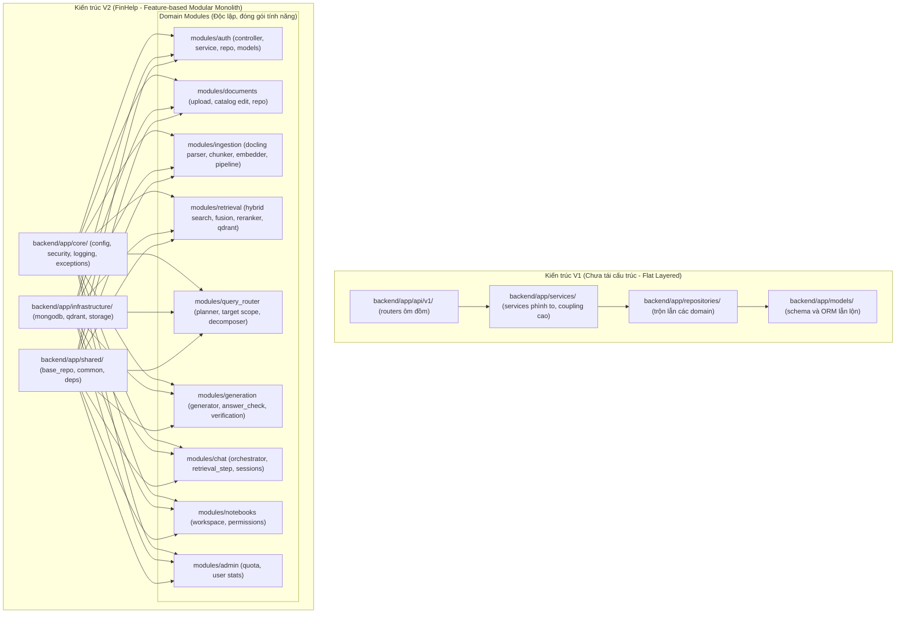

# FinHelp: Kế hoạch Phát triển & Lộ trình Hoàn thiện V2 (Dev Roadmap V2)

> **Tài liệu chiến lược & Lộ trình kỹ thuật chính thức**  
> **Dự án tốt nghiệp:** Hệ thống Trợ lý AI Phân tích & Tra cứu Báo cáo Tài chính có Kiểm chứng Số liệu (**FinHelp**)  
> **Sinh viên thực hiện:** Vương Văn Thành (MSSV: 20225094) - Trường CNTT & TT, ĐHBK Hà Nội (HUST)  
> **Cập nhật ngày:** 07/11/2026 (Phiên bản V2 sau tái cấu trúc Modular Monolith và triển khai Landing Page Router)  
> **Trạng thái quy ước:** ✅ Đã hoàn thành · 🚧 Đang triển khai · ⬜ Chưa triển khai

---

## 1. Tổng quan Tiến độ Thực hiện (Progress Tracker)

| Mã | Hạng mục công việc | Trạng thái | Ngày hoàn thành | Chi tiết kỹ thuật & Tiêu chí nghiệm thu |
|---|---|---|---|---|
| **F-1** | Chuẩn hóa `.env.example` & dọn dẹp schema rác | ✅ | 2026-10-28 | Loại bỏ các trường không dùng trong `NotebookSettings`, `UserQuota`, model rác. Bộ test 179 passed. |
| **F0** | Khởi tạo nhánh git an toàn & cấu hình hạ tầng | ✅ | 2026-11-07 | Tạo nhánh `refactor/modular-monolith` (checkpoint an toàn). Giữ Docker Compose cho MongoDB 7.0 & Qdrant v1.12. |
| **F1** | Tái cấu trúc Backend Modular Monolith (Clean Arch) | ✅ | 2026-11-07 | Di chuyển 122 files bằng `git mv` (giữ nguyên tên gốc, bảo toàn 95–100% similarity). Cập nhật 307 import statements. Bộ test **199/199 passed in 8.5s**. |
| **F2** | Chuyển bộ đánh giá sang `backend/evaluation/` | 🚧 | Dự kiến 09/11 | Port `number_check_eval.py`, `e2e_safe_flow.py`, `g3_eval.py` trỏ trực tiếp vào module mới, đo trực tiếp trên pipeline production. |
| **F3** | Frontend Router (`react-router-dom`), Landing Page & Multi-Notebook Hub | 🚧 | 2026-11-07 | Đã cài đặt `react-router-dom`, tạo Landing Page 9 section chuẩn SaaS, logo vector mới `FinHelpLogo`, modal Sơ đồ API, cấu hình định tuyến `/` và `/app`. Đang tích hợp TanStack Query và Hub quản lý Notebooks. |
| **F4** | Nâng cấp mô hình hội thoại (`focus_state`, gợi ý tiếp, 👍/👎) | ⬜ | Dự kiến 12/11 | Lưu `focus_state` (công ty, năm, chỉ tiêu) sau mỗi lượt hỏi; nhận diện câu nối tiếp không cần regex cứng; sinh gợi ý tiếp theo dạng chip; hỗ trợ phân nhánh tin nhắn `parent_message_id`. |
| **F5** | SSE Streaming (`/chat/query-stream`) & Tiến trình Ingestion | ⬜ | Dự kiến 15/11 | Chuyển luồng trả lời sang Server-Sent Events kèm token streaming mượt mà; Stepper hiển thị tiến trình (1. Phân tích câu hỏi → 2. Truy xuất tài liệu → 3. Kiểm chứng số liệu → 4. Trả lời). |
| **F6** | Hàng đợi bất đồng bộ Redis + `arq` worker | ⬜ | Dự kiến 18/11 | Tách rời tiến trình bóc tách Docling nặng ra khỏi FastAPI process; mỗi GPU worker nhận 1 task parsing/embedding qua Redis. |
| **F7** | Xác thực người dùng nâng cao & Email OTP (Resend) | ⬜ | Dự kiến 20/11 | Quên mật khẩu, gửi mã OTP kích hoạt qua Email, rate-limit chống spam brute-force. |
| **F8** | Tích hợp Cloudflare R2 Object Storage | ⬜ | Dự kiến 23/11 | Thay thế lưu trữ local disk bằng Cloudflare R2 (tương thích S3 API, miễn phí 10 GB lưu trữ, 0 đồng phí egress bandwidth). |
| **F9** | PDF Viewer nâng cao với Text Layer Highlighting | ⬜ | Dự kiến 26/11 | Tích hợp PDF.js với text layer chuẩn; click trích dẫn `[1] Trang 45` tự động cuộn và vẽ khung viền sáng quanh dòng BCTC gốc. |
| **F10** | Admin Portal toàn diện (Quản trị tri thức & Giám sát) | ⬜ | Dự kiến 29/11 | Quản lý người dùng, phân cấp hạn mức (Free/Pro/Admin), thống kê token sử dụng, nhật ký audit logs. |
| **F11** | Observability (OpenTelemetry), Dockerization & CI/CD | ⬜ | Dự kiến 03/12 | Cấu hình Dockerfile tối ưu (multi-stage build), tự động chạy test suite khi push code. |
| **F12** | Chuẩn bị Bảo vệ Đồ án Tốt nghiệp (HUST) | ⬜ | Dự kiến 10/12 | Hoàn thiện quyển báo cáo tốt nghiệp, thiết kế slide thuyết trình, quay video demo kịch bản nghiệp vụ đầy đủ. |

---

## 2. So sánh Kiến trúc V1 (Cũ) và V2 (Mới sau Tái cấu trúc)

---

## 3. Bản đồ Thiết kế Hệ thống trong Thư mục `docs/Version_2/`

Toàn bộ tài liệu phân tích thiết kế, use case và sơ đồ quy trình được tổ chức khoa học theo đúng chuẩn đề cương đồ án tốt nghiệp ĐHBK Hà Nội:

1. **Kiến trúc & Sơ đồ Tổng thể (`docs/Version_2/diagrams/`):**
   - `overview_usecase.mermaid`: Biểu đồ Use Case tổng quan toàn bộ hệ thống FinHelp (Actor: User, Admin, Support Specialist, System).
   - `system_architecture.mermaid`: Sơ đồ kiến trúc phân tầng Modular Monolith và luồng dữ liệu 4 Zone.
   - `rag_pipeline_e2e.mermaid`: Sơ đồ pipeline RAG E2E kết hợp Dense + Sparse + Qwen Reranker + Verification.
   - `database_erd.mermaid`: Sơ đồ thực thể liên kết ERD giữa MongoDB (metadata, chat, catalog) và Qdrant (vectors).
   - `diagrams_viewer.html`: Trang web hiển thị trực quan toàn bộ sơ đồ có thể zoom, xuất ảnh và thuyết trình.

2. **Chi tiết Từng Phân hệ Chức năng (`docs/Version_2/use_cases/`):**
   - `01_authentication_and_user/`: Đặc tả UC Đăng ký, Đăng nhập JWT, Quản lý tài khoản và Phân quyền Role.
   - `02_document_ingestion_and_catalog/`: Đặc tả UC Upload BCTC PDF, Bóc tách Docling, Xác nhận kỳ báo cáo/Ticker và Embedding BGE-M3.
   - `03_chat_and_rag_query/`: Đặc tả UC Truy vấn ngôn ngữ tự nhiên, Định tuyến câu hỏi đơn/đa tài liệu, Hybrid Search RRF và Rerank.
   - `04_citation_and_numerical_verification/`: Đặc tả UC Bóc tách trích dẫn trang BCTC, Kiểm tra độ chính xác số học (`answer_check/`) và Nhảy Split-View.
   - `05_workspace_and_notebooks/`: Đặc tả UC Quản lý Notebook cá nhân, Nhóm tài liệu theo danh mục đầu tư, Lịch sử trò chuyện.
   - `06_admin_and_monitoring/`: Đặc tả UC Giám sát hạn mức người dùng, Quản trị kho tài liệu công khai và Nhật ký kiểm toán.

---

## 4. Kế hoạch Triển khai Chi tiết theo Tuần (Sprint Plan)

### Tuần 1: Hoàn thiện Frontend Hub & Chuyển bộ Đánh giá (F2 + F3)
- [x] Tạo Landing Page chính thức của FinHelp (Bản 1 Modern Centered).
- [x] Thiết kế Logo nhận diện FinHelp mới, loại bỏ chữ "FH" đơn điệu.
- [x] Cài đặt `react-router-dom` và sửa dứt điểm lỗi CSS Tailwind v4 trên Vite.
- [ ] Chuyển bộ script đánh giá (`g3_eval.py`, `number_check_eval.py`, `e2e_safe_flow.py`) vào `backend/evaluation/`.
- [ ] Tích hợp `@tanstack/react-query` vào frontend để loại bỏ polling thủ công.
- [ ] Xây dựng giao diện Multi-Notebook Hub (`/app`) cho phép tạo, sửa tên, xoá notebook.

### Tuần 2: Nâng cấp Trải nghiệm Hội thoại & Streaming (F4 + F5)
- [ ] Thêm `focus_state` vào bảng `conversations` (MongoDB) lưu giữ ngữ cảnh: Công ty, Năm tài chính, Chỉ tiêu.
- [ ] Triển khai thuật ngữ nhận diện câu hỏi thiếu chủ thể (Contextual Follow-up Resolution).
- [ ] Sinh chip gợi ý câu hỏi tiếp theo dựa trên chỉ số tài chính liên quan.
- [ ] Xây dựng endpoint SSE `POST /api/v1/chat/query-stream` trả về tiến trình Stepper và token chữ mượt mà.

### Tuần 3: Tối ưu Hạ tầng Ingestion & Bộ nhớ đệm (F6 + F7 + F8)
- [ ] Cài đặt hàng đợi `arq` trên Redis để xử lý tác vụ Docling PDF nặng trong background.
- [ ] Tích hợp dịch vụ gửi Email OTP (Resend API) cho tính năng Quên mật khẩu và Kích hoạt tài khoản.
- [ ] Kết nối Cloudflare R2 lưu trữ file PDF gốc, hỗ trợ signed URL an toàn.

### Tuần 4: Đánh giá Chất lượng, Admin Portal & Báo cáo Tốt nghiệp (F9 + F10 + F12)
- [ ] Nâng cấp PDF Viewer với khả năng tự động tô sáng vùng trích dẫn (Text Layer Bounding Box).
- [ ] Xây dựng Admin Dashboard quản lý User, Quota và Logs.
- [ ] Chạy bộ benchmark đo lường toàn diện (Recall@k, Precision, Grounding Accuracy, Latency).
- [ ] Viết báo cáo tốt nghiệp chuẩn theo format Đại học Bách Khoa Hà Nội.

