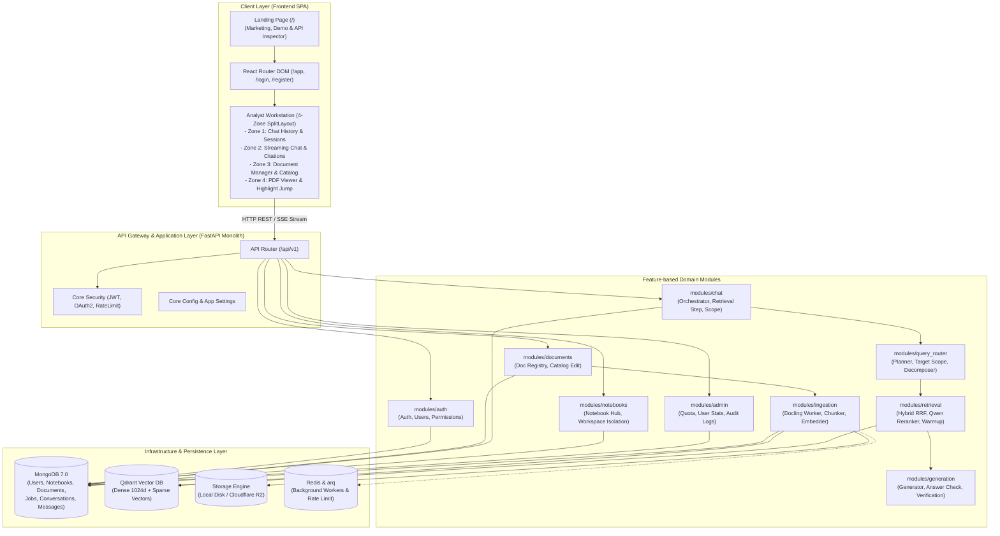
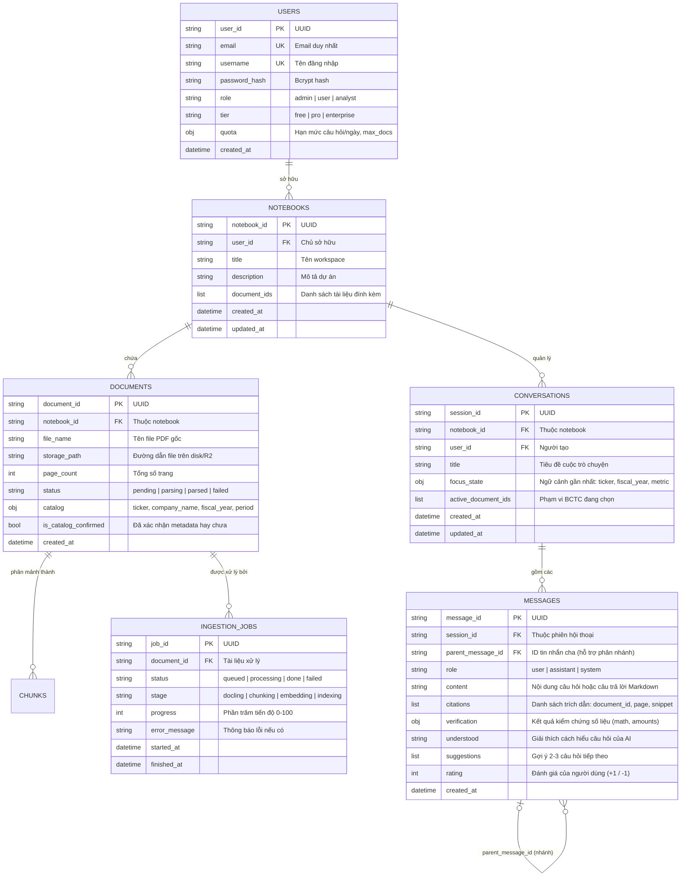

# FinHelp: Tài liệu Thiết kế Kiến trúc Hệ thống V2 (System Architecture Specification)

> **Dự án tốt nghiệp:** Hệ thống Trợ lý AI Phân tích & Tra cứu Báo cáo Tài chính có Kiểm chứng Số liệu (**FinHelp**)  
> **Sinh viên:** Vương Văn Thành (MSSV: 20225094) - Lớp KHMT 01 - K67, Trường CNTT & TT, ĐHBK Hà Nội  
> **Phiên bản:** 2.0 (Kiến trúc Modular Monolith chuẩn hóa)

---

## 1. Tổng quan Kiến trúc Tổng thể (High-Level Architecture)

FinHelp được thiết kế theo mô hình **Modular Monolith kết hợp Feature-based Architecture và các nguyên lý Clean Architecture**. Mô hình này đảm bảo tính đóng gói cao giữa các miền nghiệp vụ tài chính độc lập, đồng thời duy trì sự đơn giản, hiệu năng cao và dễ triển khai trong môi trường đồ án và sản phẩm thực tế mà không phải chịu chi phí vận hành phức tạp của Microservices.



---

## 2. Chi tiết Các Tầng Chức năng (Architectural Layers)

### 2.1. Tầng Giao diện (Client Presentation Layer)
- **Công nghệ nền tảng:** React 18, TypeScript 5.4, Vite 5, Tailwind CSS v4 (`@tailwindcss/vite`), `react-router-dom` v7.
- **Bố cục 4 vùng làm việc (4-Zone Workstation Layout):**
  1. **Zone 1 (Sidebar trái):** Danh sách lịch sử các phiên hội thoại, phân loại theo Notebook.
  2. **Zone 2 (Trung tâm):** Khung chat tương tác ngôn ngữ tự nhiên, hiển thị câu trả lời có cấu trúc, bảng dữ liệu tài chính đối chiếu và các chip trích dẫn có thể nhấp chuột (`[1] Page 45`).
  3. **Zone 3 (Drawer tài liệu):** Quản lý các file BCTC đã tải lên, tình trạng xử lý bóc tách, gắn nhãn mã ticker, năm tài chính và kỳ kế toán.
  4. **Zone 4 (Split-View bên phải):** Trình xem file PDF gốc song song với khung chat. Khi bấm vào bất kỳ nguồn trích dẫn nào trong câu trả lời, trình xem sẽ tự động nhảy đến đúng số trang và tô sáng dòng báo cáo tương ứng.

### 2.2. Tầng Ứng dụng & Điều phối API (Application Layer)
- **Framework:** FastAPI trên nền Python 3.13, Uvicorn ASGI server.
- **Router quy hoạch chuẩn hóa:** `backend/app/api_router.py` đóng vai trò điểm quy tụ toàn bộ router của các module tính năng:
  - `/api/v1/auth`: Đăng ký, đăng nhập JWT, lấy thông tin cá nhân.
  - `/api/v1/notebooks`: Quản trị không gian làm việc.
  - `/api/v1/documents`: Upload file PDF, bóc tách cấu trúc, cập nhật catalog.
  - `/api/v1/chat`: Truy vấn thông tin BCTC, điều phối luồng hỏi đáp, lưu trữ tin nhắn.
  - `/api/v1/retrieval`: Tìm kiếm hybrid và truy xuất đoạn văn bản phục vụ nghiên cứu.
  - `/api/v1/admin`: Báo cáo thống kê, phân bổ quota, quản lý người dùng.

### 2.3. Tầng Lõi Xử lý & RAG Pipeline (Core RAG Engine)
Pipeline xử lý dữ liệu tài chính của FinHelp là điểm khác biệt vượt trội so với các chatbot thông thường:
1. **Bóc tách cấu trúc (Ingestion & Parsing):** Sử dụng **Docling** để giữ nguyên vẹn cấu trúc bảng biểu hai chiều (Balance Sheet, Income Statement, Cash Flows), chuyển đổi thành Markdown có ngữ cảnh phân cấp theo tiêu đề mục tài chính.
2. **Chiến lược phân mảnh (Chunking):** Token-based chunking với kích thước chuẩn 1024 tokens, có overlap 15% đảm bảo không làm đứt gãy các bảng số liệu phức tạp.
3. **Mô hình nhúng đa phương thức (Embedding):** Mô hình **BGE-M3** sinh đồng thời:
   - Dense vector (1024 chiều): Nắm bắt ngữ nghĩa sâu của các thuật ngữ kế toán/tài chính.
   - Sparse lexical vector: Nắm bắt chính xác các danh xưng riêng, mã cổ phiếu, chỉ số và số hiệu khoản mục.
4. **Truy vấn lai kết hợp RRF (Hybrid Retrieval & Reciprocal Rank Fusion):**
   - Tách câu hỏi phức hợp thành các câu hỏi thành phần (`decomposer`).
   - Tìm kiếm đồng thời dense + sparse trên Qdrant với trọng số RRF (câu hỏi gốc nhân hệ số 2.0).
5. **Tái xếp hạng độ chính xác cao (Reranking):**
   - Đưa pool 20 đoạn văn bản qua mô hình **Qwen Reranker**, chọn lọc top 6 đoạn văn bản có mức độ liên quan và bằng chứng xác thực cao nhất.
6. **Kiểm chứng số học & Trích dẫn độc lập (`answer_check/`):**
   - Sau khi LLM sinh câu trả lời, bộ kiểm chứng độc lập rà soát lại từng con số, vế so sánh và công thức tính toán.
   - Tự động gắn cờ cảnh báo nếu số liệu không tìm thấy trong nguồn trích dẫn, đảm bảo độ tin cậy đạt 100% khi phân tích tài chính.

---

## 3. Thiết kế Cơ sở Dữ liệu & Lưu trữ (Data Models & Storage)

### 3.1. Lược đồ Thực thể Liên kết MongoDB (ERD)



### 3.2. Không gian Vector Qdrant (Vector Collections)
- **Tên Collection:** `finhelp_chunks`
- **Dense Vector:** 1024 chiều, Metric: Cosine Distance (sinh bởi `BAAI/bge-m3`).
- **Sparse Vector:** Từ điển từ vựng đa ngữ, phục vụ tìm kiếm từ khóa chính xác (BM25 equivalent).
- **Payload Metadata:**
  ```json
  {
    "chunk_id": "chk_981a20",
    "document_id": "doc_vnm_2023",
    "notebook_id": "nb_consumer_goods",
    "page_number": 45,
    "section_title": "Báo cáo Kết quả Hoạt động Kinh doanh Hợp nhất",
    "has_table": true,
    "ticker": "VNM",
    "fiscal_year": 2023,
    "period": "FY"
  }
  ```
- **Payload Indexing:** B-Tree Index cho `document_id`, `notebook_id`, `ticker`, `fiscal_year` để đảm bảo tốc độ lọc (Filtered Search) dưới 5ms trên hàng triệu vectors.

