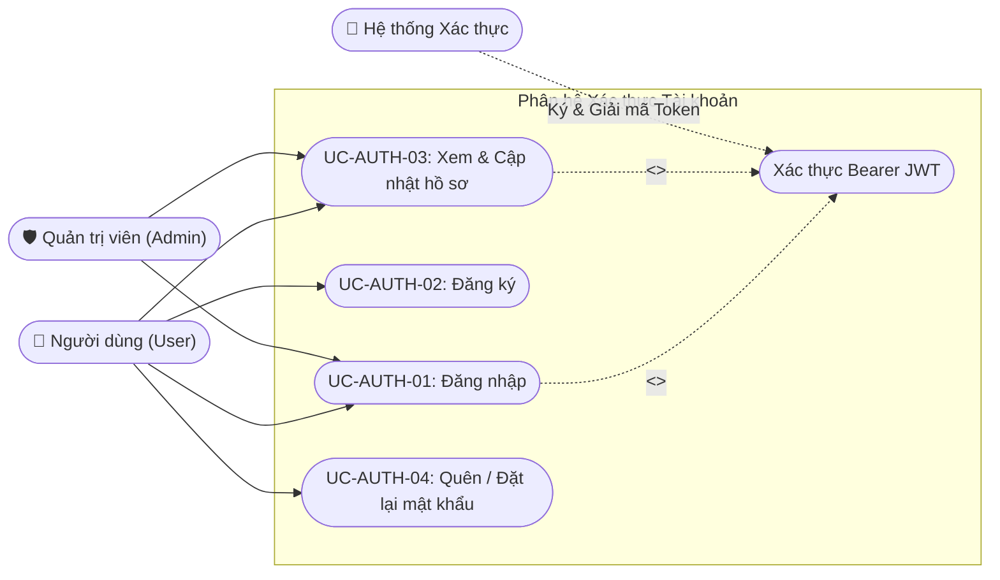
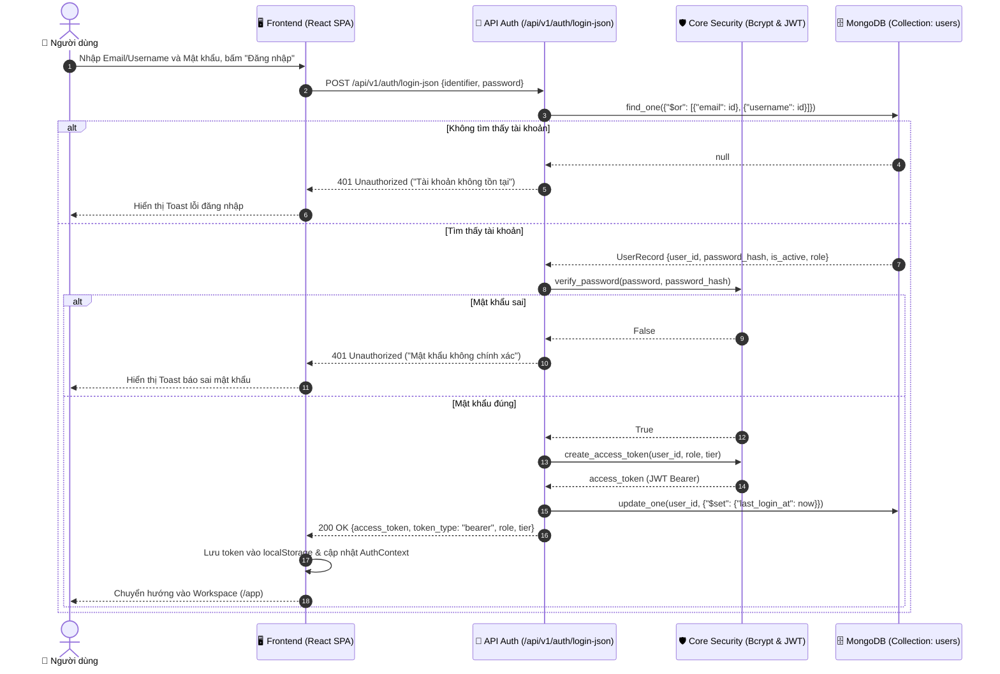

# Phân hệ 1: Xác thực & Quản lý Người dùng (Authentication & User Management)

> **Mã phân hệ:** `MOD-AUTH`  
> **Tác nhân tham gia:** `User` (Người dùng), `Admin` (Quản trị viên), `System` (Hệ thống xác thực JWT)

---

## 1. Biểu đồ Phân rã Use Case (Use Case Decomposition Diagram)

---

## 2. Bảng Đặc tả Chi tiết Các Use Case

### Bảng 2.1: Đặc tả Use Case "UC-AUTH-01: Đăng nhập hệ thống"

| Thuộc tính | Nội dung chi tiết |
|---|---|
| **Mã Use Case** | `UC-AUTH-01` |
| **Tên Use Case** | Đăng nhập hệ thống (User Login) |
| **Tác nhân** | Người dùng (`User`), Quản trị viên (`Admin`), Hệ thống (`System`) |
| **Mô tả** | Người dùng gửi thông tin định danh (email/username) và mật khẩu để xác thực quyền truy cập vào hệ thống FinHelp. |
| **Điều kiện tiên quyết** | Người dùng đã có tài khoản hợp lệ được lưu trong cơ sở dữ liệu `users` của MongoDB. |
| **Điều kiện sau** | Hệ thống cấp Access Token (JWT Bearer) có thời hạn, người dùng được chuyển vào màn hình Workspace hoặc Admin Dashboard tương ứng với vai trò. |
| **Luồng sự kiện chính (Main Flow)** | 1. Người dùng bấm nút "Sign in" trên thanh Navbar của Landing Page. 2. Giao diện hiển thị Modal Đăng nhập. 3. Người dùng nhập Email (hoặc Username) và Mật khẩu, sau đó bấm "Đăng nhập". 4. Hệ thống kiểm tra tài khoản trong bảng `users`, mã hóa và so khớp mật khẩu bằng hàm băm `bcrypt`. 5. Hệ thống kiểm tra cờ `is_active = True`. 6. Hệ thống tạo chuỗi JWT Access Token chứa `user_id`, `role`, `tier` và thời hạn hết hạn (`exp`). 7. Hệ thống cập nhật thời gian đăng nhập gần nhất `last_login_at` vào cơ sở dữ liệu. 8. Frontend lưu token vào `localStorage`, cập nhật `AuthContext` và điều hướng người dùng vào `/app` (Workspace). 9. Hoàn thành Use Case. |
| **Luồng thay thế / Ngoại lệ (Alternative Flows)** | **4a. Thông tin đăng nhập không chính xác:** - Hệ thống trả về mã lỗi `HTTP 401 Unauthorized` kèm thông báo *"Tên đăng nhập hoặc mật khẩu không chính xác"*. - Giao diện hiển thị thông báo lỗi (Toast đỏ), giữ nguyên màn hình để người dùng nhập lại.  **5a. Tài khoản bị vô hiệu hóa:** - Nếu `is_active = False`, hệ thống từ chối đăng nhập với mã lỗi `HTTP 403 Forbidden` và thông báo *"Tài khoản đã bị tạm khóa bởi quản trị viên"*. |

---

### Bảng 2.2: Đặc tả Use Case "UC-AUTH-02: Đăng ký tài khoản"

| Thuộc tính | Nội dung chi tiết |
|---|---|
| **Mã Use Case** | `UC-AUTH-02` |
| **Tên Use Case** | Đăng ký tài khoản mới (User Registration) |
| **Tác nhân** | Khách vãng lai (`Guest User`), Hệ thống (`System`) |
| **Mô tả** | Người dùng tạo tài khoản mới để lưu trữ các báo cáo tài chính và lịch sử phân tích cá nhân. |
| **Điều kiện tiên quyết** | Email chưa từng được đăng ký trong hệ thống. |
| **Điều kiện sau** | Bản ghi người dùng mới được tạo trong bảng `users`, đồng thời một Notebook mặc định ("Phân tích BCTC Mặc định") được tự động khởi tạo. |
| **Luồng sự kiện chính (Main Flow)** | 1. Người dùng bấm "Get Started" hoặc chuyển sang tab "Đăng ký" trên Auth Modal. 2. Người dùng nhập Email, Username, Họ và tên, Mật khẩu (ít nhất 8 ký tự). 3. Người dùng bấm nút "Tạo tài khoản". 4. Hệ thống kiểm tra định dạng email và tính duy nhất của Email/Username trong cơ sở dữ liệu. 5. Hệ thống băm mật khẩu bằng thuật toán `bcrypt` an toàn. 6. Hệ thống tạo tài khoản mới với vai trò mặc định `role: "user"`, gói `tier: "free"` kèm hạn mức phân tích (`quota: 50 câu/ngày`). 7. Hệ thống tự động tạo một Notebook khởi tạo cho người dùng trong bảng `notebooks`. 8. Hệ thống tự động đăng nhập, trả về JWT Access Token. 9. Giao diện hiển thị thông báo thành công và chuyển thẳng vào Workspace. |
| **Luồng thay thế / Ngoại lệ** | **4a. Email hoặc Username đã tồn tại:** - Hệ thống trả về `HTTP 400 Bad Request` kèm thông báo cụ thể *"Email đã được sử dụng bởi tài khoản khác"*. **4b. Mật khẩu không đủ mạnh:** - Hệ thống yêu cầu mật khẩu phải có độ dài tối thiểu 8 ký tự và chứa ký tự chữ và số. |

---

## 3. Biểu đồ Tuần tự Luồng Đăng nhập (Sequence Diagram)

