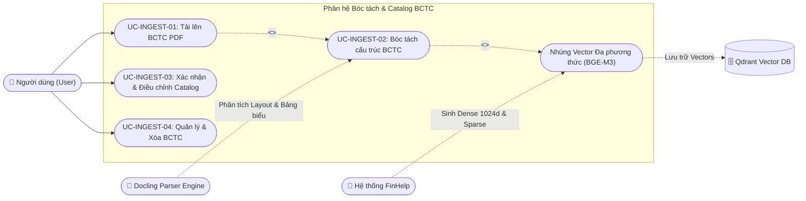
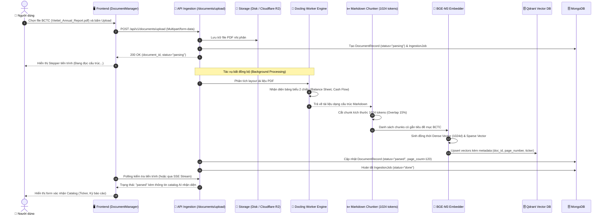

# Phân hệ 2: Tải lên, Bóc tách & Quản lý Catalog BCTC (Document Ingestion & Catalog)

> **Mã phân hệ:** `MOD-INGEST`  
> **Tác nhân tham gia:** `User` (Chuyên viên PTTC), `Docling Worker` (Bộ xử lý bóc tách tài liệu), `Qdrant` (Cơ sở dữ liệu Vector), `System`

---

## 1. Biểu đồ Phân rã Use Case (Use Case Decomposition Diagram)

---

## 2. Bảng Đặc tả Chi tiết Các Use Case

### Bảng 2.1: Đặc tả Use Case "UC-INGEST-01: Tải lên BCTC dạng PDF"

| Thuộc tính | Nội dung chi tiết |
|---|---|
| **Mã Use Case** | `UC-INGEST-01` |
| **Tên Use Case** | Tải lên tài liệu BCTC PDF (Upload Financial Report) |
| **Tác nhân** | Người dùng (`User`), Hệ thống (`System`) |
| **Mô tả** | Người dùng tải lên các file báo cáo tài chính định dạng PDF (Báo cáo thường niên, BCTC kiểm toán, BCTC quý) vào một Notebook phân tích. |
| **Điều kiện tiên quyết** | Người dùng đang mở một Notebook hợp lệ; file tải lên có đuôi `.pdf` và dung lượng hợp lệ (< 50MB). |
| **Điều kiện sau** | File PDF được lưu vào hệ thống lưu trữ (Local Storage / Cloudflare R2), bản ghi tài liệu được tạo trong bảng `documents` với trạng thái `pending`, và một tác vụ xử lý nền `IngestionJob` được kích hoạt. |
| **Luồng sự kiện chính (Main Flow)** | 1. Người dùng mở Drawer "Nguồn tài liệu" trong Workspace. 2. Người dùng kéo-thả hoặc bấm chọn một hoặc nhiều file PDF từ máy tính. 3. Frontend kiểm tra định dạng file và dung lượng hợp lệ. 4. Frontend gửi yêu cầu `POST /api/v1/documents/upload` kèm file multipart và `notebook_id`. 5. Hệ thống kiểm tra hạn mức tải tài liệu (`max_upload_documents` trong `quota`). 6. Hệ thống lưu file PDF vào kho lưu trữ an toàn, tính mã băm MD5 để chống trùng lặp file. 7. Hệ thống tạo bản ghi mới trong bảng `documents` và khởi tạo `IngestionJobRecord` (trạng thái: `parsing`). 8. Hệ thống gọi LLM suy luận ban đầu để trích xuất sơ bộ: Mã cổ phiếu, Công ty, Năm tài chính, Kỳ báo cáo. 9. Hệ thống gửi task bóc tách tài liệu vào hàng đợi xử lý. 10. Trả về mã `document_id` và thông báo tải lên thành công cho người dùng. |
| **Luồng thay thế / Ngoại lệ** | **3a. File sai định dạng:** - Nếu file không phải đuôi `.pdf`, hệ thống từ chối ngay tại giao diện với thông báo *"Chỉ hỗ trợ tài liệu định dạng PDF"**. **5a. Vượt quá hạn mức gói dịch vụ:** - Trả về `HTTP 403 Forbidden`: *"Bạn đã đạt giới hạn tối đa số tài liệu cho phép của gói dịch vụ. Vui lòng nâng cấp gói hoặc xóa bớt tài liệu cũ"*. |

---

### Bảng 2.2: Đặc tả Use Case "UC-INGEST-03: Xác nhận & Điều chỉnh Catalog BCTC"

| Thuộc tính | Nội dung chi tiết |
|---|---|
| **Mã Use Case** | `UC-INGEST-03` |
| **Tên Use Case** | Xác nhận & Điều chỉnh Catalog BCTC (Catalog Edit & Confirmation) |
| **Tác nhân** | Người dùng (`User`), Hệ thống (`System`) |
| **Mô tả** | Người dùng xác nhận hoặc điều chỉnh lại các trường metadata quan trọng của tài liệu (Mã cổ phiếu Ticker, Năm tài chính, Kỳ báo cáo, Trạng thái kiểm toán) để đảm bảo độ chính xác tuyệt đối khi phân tích đa tài liệu. |
| **Điều kiện tiên quyết** | Tài liệu BCTC đã được hệ thống bóc tách sơ bộ và hiển thị banner yêu cầu xác nhận. |
| **Điều kiện sau** | Metadata tài liệu được cập nhật trong bảng `documents`, cờ `is_catalog_confirmed` chuyển sang `True`, cho phép hệ thống áp dụng bộ lọc chính xác khi truy vấn. |
| **Luồng sự kiện chính (Main Flow)** | 1. Sau khi upload, giao diện hiển thị banner cảnh báo: *"Cần xác nhận thông tin tài liệu trước khi hỏi..."*. 2. Người dùng bấm nút "Xác nhận" trên banner hoặc icon chỉnh sửa tại danh sách tài liệu. 3. Modal `CatalogForm` mở ra, hiển thị các thông tin do AI tự động nhận diện trước đó. 4. Người dùng kiểm tra và có thể chỉnh sửa: Mã chứng khoán (Ticker), Tên doanh nghiệp, Năm tài chính (Fiscal Year), Kỳ kế toán (Cả năm / Quý 1-4), Có kiểm toán hay chưa. 5. Người dùng bấm "Lưu thông tin". 6. Frontend gửi yêu cầu `PATCH /api/v1/documents/{id}/catalog`. 7. Hệ thống cập nhật bảng `documents` và cập nhật payload metadata của các vector chunk liên kết trong Qdrant. 8. Banner cảnh báo tự động đóng, tài liệu sẵn sàng 100% để truy vấn. |

---

## 3. Biểu đồ Tuần tự Luồng Bóc tách BCTC (Sequence Diagram)

