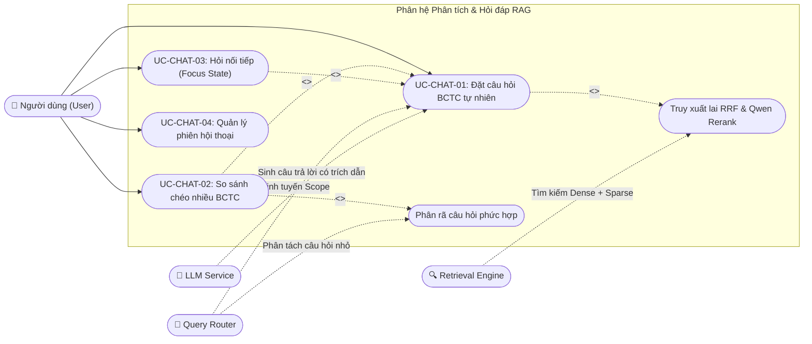
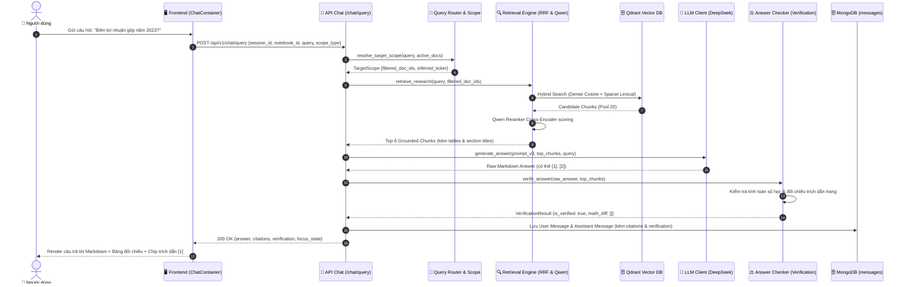

# Phân hệ 3: Hỏi đáp & Truy vấn RAG Tài chính (Chat & Financial RAG Query)

> **Mã phân hệ:** `MOD-CHAT`  
> **Tác nhân tham gia:** `User` (Người dùng), `Query Router` (Bộ định tuyến câu hỏi), `Retrieval Engine` (Bộ truy xuất lai RRF & Reranker), `LLM` (Mô hình ngôn ngữ lớn), `System`

---

## 1. Biểu đồ Phân rã Use Case (Use Case Decomposition Diagram)

---

## 2. Bảng Đặc tả Chi tiết Các Use Case

### Bảng 2.1: Đặc tả Use Case "UC-CHAT-01: Đặt câu hỏi phân tích BCTC"

| Thuộc tính | Nội dung chi tiết |
|---|---|
| **Mã Use Case** | `UC-CHAT-01` |
| **Tên Use Case** | Đặt câu hỏi phân tích BCTC ngôn ngữ tự nhiên (Financial Q&A) |
| **Tác nhân** | Người dùng (`User`), Hệ thống (`System`), Mô hình ngôn ngữ (`LLM`) |
| **Mô tả** | Người dùng nhập câu hỏi bằng tiếng Việt hoặc tiếng Anh về các số liệu, chỉ số tài chính, xu hướng tăng trưởng hoặc thuyết minh BCTC; hệ thống tự động tìm kiếm bằng chứng và trả về câu trả lời có căn cứ xác thực. |
| **Điều kiện tiên quyết** | Người dùng đã mở một phiên hội thoại và có ít nhất 1 tài liệu BCTC đã được bóc tách hoàn tất (`status = parsed`). |
| **Điều kiện sau** | Câu hỏi và câu trả lời kèm các nguồn trích dẫn được lưu vào bảng `messages`; trạng thái ngữ cảnh `focus_state` của phiên được cập nhật. |
| **Luồng sự kiện chính (Main Flow)** | 1. Người dùng nhập câu hỏi vào ô chat (ví dụ: *"Doanh thu thuần và lợi nhuận gộp của công ty năm 2023 là bao nhiêu?"*). 2. Người dùng bấm gửi tin nhắn. 3. Frontend hiển thị bong bóng tin nhắn của người dùng và kích hoạt hiệu ứng chờ xử lý. 4. Backend tiếp nhận yêu cầu qua `POST /api/v1/chat/query`. 5. **Query Router** kiểm tra phạm vi tài liệu (1 tài liệu được chỉ định hoặc toàn bộ tài liệu trong phiên). 6. **Retrieval Engine** thực hiện nhúng câu hỏi bằng `BGE-M3` và tìm kiếm lai Dense + Sparse trên Qdrant. 7. Hệ thống áp dụng thuật toán **RRF** kết hợp kết quả câu hỏi gốc (trọng số 2.0x) và tái xếp hạng bằng **Qwen Reranker**, chọn ra top 6 đoạn văn bản có độ liên quan cao nhất. 8. Hệ thống lắp ráp Prompt v3 chuyên sâu tài chính, gửi đến LLM (DeepSeek). 9. LLM sinh câu trả lời có cấu trúc Markdown, tính toán tỷ lệ phần trăm và gắn các thẻ trích dẫn dạng `[1] Page 45`. 10. Hệ thống chạy bộ kiểm chứng số học (`answer_check/`) để đối chiếu các con số với văn bản gốc. 11. Hệ thống lưu tin nhắn vào MongoDB và trả về phản hồi kèm danh sách trích dẫn và nhãn kiểm chứng cho Frontend. 12. Frontend hiển thị câu trả lời, bảng số liệu và các chip trích dẫn tương tác. |
| **Luồng thay thế / Ngoại lệ** | **5a. Không tìm thấy tài liệu liên quan:** - Nếu độ tương đồng dưới ngưỡng cho phép, hệ thống trả về thông báo: *"Không tìm thấy thông tin phù hợp trong các báo cáo tài chính đã chọn để trả lời câu hỏi này"*, tuyệt đối không tự bịa đặt số liệu. **10a. Phát hiện số liệu tính toán không khớp:** - Hệ thống tự động đính kèm cờ cảnh báo `⚠️ Số liệu chưa được kiểm chứng hoàn toàn` trên giao diện. |

---

### Bảng 2.2: Đặc tả Use Case "UC-CHAT-02: So sánh chéo nhiều BCTC"

| Thuộc tính | Nội dung chi tiết |
|---|---|
| **Mã Use Case** | `UC-CHAT-02` |
| **Tên Use Case** | So sánh chéo nhiều BCTC (Multi-document Financial Comparison) |
| **Tác nhân** | Người dùng (`User`), Hệ thống (`System`), Mô hình ngôn ngữ (`LLM`) |
| **Mô tả** | Người dùng đặt câu hỏi yêu cầu so sánh các chỉ tiêu tài chính giữa hai hoặc nhiều doanh nghiệp khác nhau (ví dụ: FPT vs CMG), hoặc giữa các năm tài chính khác nhau của cùng một doanh nghiệp. |
| **Điều kiện tiên quyết** | Có ít nhất 2 tài liệu BCTC tương ứng đã được chọn trong phạm vi phân tích. |
| **Điều kiện sau** | Câu trả lời trả về bảng đối chiếu song song giữa các thực thể, chỉ rõ từng nguồn trích dẫn từ từng file PDF riêng biệt. |
| **Luồng sự kiện chính (Main Flow)** | 1. Người dùng chọn 2 hoặc nhiều BCTC trong Drawer tài liệu. 2. Người dùng nhập câu hỏi so sánh: *"So sánh tốc độ tăng trưởng doanh thu và biên lợi nhuận ròng giữa Vinamilk và TH True Milk năm 2023"**. 3. **Query Router** nhận diện đây là bài toán so sánh đa tài liệu (`scope_type = "explicit"`). 4. Bộ phân rã (`decomposer`) tách câu hỏi lớn thành các câu hỏi con độc lập cho từng công ty. 5. Hệ thống truy xuất độc lập các đoạn báo cáo tài chính của từng công ty từ Qdrant. 6. Lắp ghép ngữ cảnh tổng hợp từ cả hai nguồn tài liệu. 7. LLM tính toán chỉ số chênh lệch, tỷ lệ tăng trưởng YoY và lập bảng so sánh Markdown chuẩn mực. 8. Gắn trích dẫn tách bạch: `[1] BCTC Công ty A - Trang 45`, `[2] BCTC Công ty B - Trang 32`. 9. Trả kết quả hiển thị cho người dùng. |

---

## 3. Biểu đồ Tuần tự Luồng Hỏi đáp RAG (Sequence Diagram)

