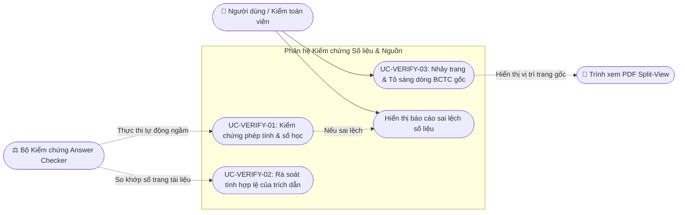
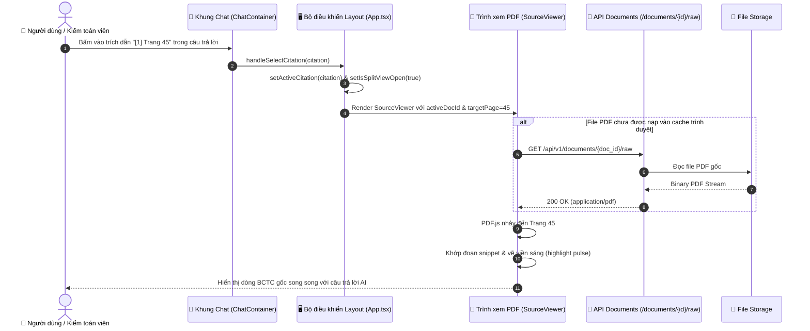

# Phân hệ 4: Kiểm chứng Số liệu & Đối chiếu Trích dẫn (Citation & Numerical Verification)

> **Mã phân hệ:** `MOD-VERIFY`  
> **Tác nhân tham gia:** `User` (Người dùng / Kiểm toán viên), `Answer Checker` (Bộ kiểm chứng số học độc lập), `PDF Split-View` (Trình xem văn bản song song), `System`

---

## 1. Biểu đồ Phân rã Use Case (Use Case Decomposition Diagram)

---

## 2. Bảng Đặc tả Chi tiết Các Use Case

### Bảng 2.1: Đặc tả Use Case "UC-VERIFY-01: Kiểm chứng phép tính & số học BCTC"

| Thuộc tính | Nội dung chi tiết |
|---|---|
| **Mã Use Case** | `UC-VERIFY-01` |
| **Tên Use Case** | Kiểm chứng phép tính & số học tài chính (Numerical & Math Verification) |
| **Tác nhân** | Hệ thống (`System`), Bộ kiểm chứng (`Answer Checker`) |
| **Mô tả** | Sau khi mô hình ngôn ngữ lớn (LLM) sinh câu trả lời, hệ thống tự động bóc tách toàn bộ số liệu, phép tính cộng trừ nhân chia, tỷ lệ phần trăm (YoY growth, biên lợi nhuận, FCF) và đối chiếu lại với các số liệu gốc có trong các chunk văn bản để phát hiện hiện tượng ảo giác (hallucination) hoặc tính toán sai lệch. |
| **Điều kiện tiên quyết** | Câu trả lời thô vừa được LLM tạo ra, kèm danh sách các đoạn văn bản (chunks) được dùng làm ngữ cảnh. |
| **Điều kiện sau** | Gắn nhãn kiểm chứng vào bản ghi tin nhắn: nếu 100% số liệu khớp thì gắn `✓ Grounded & Verified`; nếu phát hiện số liệu tự bịa hoặc tính toán sai thì gắn nhãn cảnh báo `⚠️ Số liệu cần xác minh lại` kèm báo cáo chi tiết các con số sai lệch. |
| **Luồng sự kiện chính (Main Flow)** | 1. Hệ thống chuyển câu trả lời thô vào module `modules/generation/answer_check/checker.py`. 2. Hàm `extract_numbers()` bóc tách toàn bộ số nguyên, số thực, đơn vị tiền tệ (tỷ đồng, triệu USD) và tỷ lệ % có trong câu trả lời. 3. Hàm `check_amounts()` so khớp từng số trích xuất với bảng biểu và văn bản trong top 6 chunks ngữ cảnh. 4. Hàm `check_math()` phân tích cú pháp các biểu thức toán học (ví dụ: `FCF = 12,195 - 9,102 = 3,093` hoặc tăng trưởng `(17,902 - 14,200)/14,200 = 26.1%`) và tính toán lại bằng Python độc lập. 5. Nếu kết quả tính toán khớp và toàn bộ con số đều xuất hiện trong tài liệu gốc, hệ thống đánh giá `is_verified = True`. 6. Hệ thống đóng gói `verification` metadata và lưu cùng tin nhắn vào cơ sở dữ liệu. |
| **Luồng thay thế / Ngoại lệ** | **4a. Phát hiện sai lệch số học hoặc hallucination:** - Hệ thống tạo `diff_report` liệt kê các con số không tìm thấy hoặc kết quả tính sai. - Hệ thống tự động bổ sung ghi chú cảnh báo ngay dưới câu trả lời trước khi gửi tới người dùng. |

---

### Bảng 2.2: Đặc tả Use Case "UC-VERIFY-03: Nhảy trang & Tô sáng dòng BCTC gốc"

| Thuộc tính | Nội dung chi tiết |
|---|---|
| **Mã Use Case** | `UC-VERIFY-03` |
| **Tên Use Case** | Nhảy trang & Tô sáng dòng BCTC gốc (Split-View Citation Jump) |
| **Tác nhân** | Người dùng (`User`), Trình xem PDF (`PDF Split-View`) |
| **Mô tả** | Người dùng nhấp chuột vào một chip trích dẫn (ví dụ: `[1] Page 45`) trong câu trả lời của AI; hệ thống tự động mở khung Split-View bên phải, chuyển đúng tài liệu BCTC, cuộn đến đúng số trang và vẽ khung viền sáng (highlight) quanh dòng số liệu liên quan. |
| **Điều kiện tiên quyết** | Câu trả lời chứa ít nhất một trích dẫn hợp lệ; file PDF gốc tồn tại trên hệ thống lưu trữ. |
| **Điều kiện sau** | Màn hình được chia đôi (50/50 hoặc 60/40), tài liệu gốc được hiển thị tại đúng vị trí trích dẫn để người dùng kiểm chứng bằng mắt trong 1 giây. |
| **Luồng sự kiện chính (Main Flow)** | 1. Người dùng đọc câu trả lời trong ChatContainer và thấy chip trích dẫn `[1] Page 45`. 2. Người dùng nhấp chuột vào chip trích dẫn. 3. Sự kiện `onSelectCitation(citation)` được kích hoạt. 4. Trạng thái `isSplitViewOpen` chuyển sang `true`, `activeDocId` chuyển sang `document_id` của trích dẫn. 5. Khung `SourceViewer` bên phải tải file PDF từ endpoint `GET /api/v1/documents/{id}/raw`. 6. Trình xem PDF tự động chuyển hướng đến trang được chỉ định (`#page=45`). 7. Hệ thống tìm kiếm đoạn trích (snippet) hoặc tọa độ dòng bảng trên Text Layer của PDF và kích hoạt hiệu ứng nhấp nháy sáng (`citation-pulse`). 8. Người dùng hoàn toàn yên tâm về tính xác thực của số liệu mà không cần phải lật mở tài liệu thủ công. |

---

## 3. Biểu đồ Tuần tự Luồng Đối chiếu Trích dẫn (Sequence Diagram)

