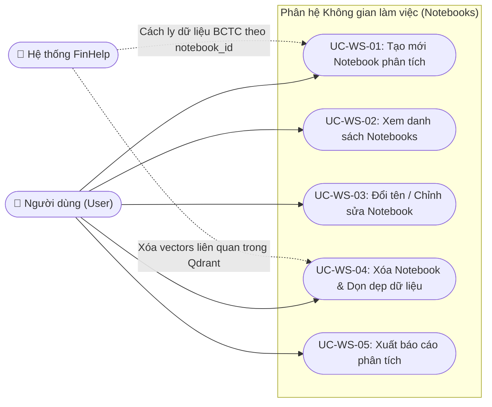
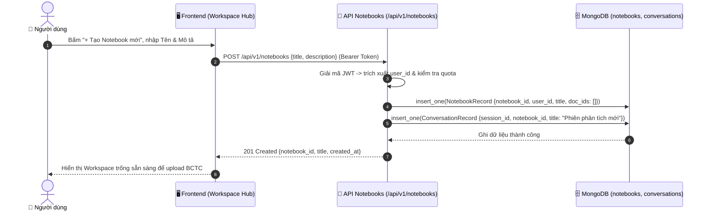

# Phân hệ 5: Quản lý Không gian làm việc & Notebooks (Workspace & Notebook Management)

> **Mã phân hệ:** `MOD-NOTE`  
> **Tác nhân tham gia:** `User` (Chuyên viên PTTC), `System` (Hệ thống phân tách dữ liệu)

---

## 1. Biểu đồ Phân rã Use Case (Use Case Decomposition Diagram)

---

## 2. Bảng Đặc tả Chi tiết Các Use Case

### Bảng 2.1: Đặc tả Use Case "UC-WS-01: Tạo mới Notebook phân tích"

| Thuộc tính | Nội dung chi tiết |
|---|---|
| **Mã Use Case** | `UC-WS-01` |
| **Tên Use Case** | Tạo mới Notebook phân tích (Create Analysis Notebook) |
| **Tác nhân** | Người dùng (`User`), Hệ thống (`System`) |
| **Mô tả** | Người dùng tạo một không gian làm việc (Notebook) riêng biệt để nhóm các báo cáo tài chính của một ngành hoặc một danh mục đầu tư cụ thể (ví dụ: "Ngành Bán lẻ 2023", "So sánh Ngân hàng Q3/2024"). |
| **Điều kiện tiên quyết** | Người dùng đã đăng nhập hệ thống; chưa vượt quá số lượng notebook tối đa theo gói hạn mức. |
| **Điều kiện sau** | Một bản ghi `NotebookRecord` mới được lưu vào MongoDB; các tài liệu và câu hỏi sau đó được cách ly hoàn toàn bên trong Notebook này. |
| **Luồng sự kiện chính (Main Flow)** | 1. Người dùng bấm nút "+ Tạo Notebook Mới" trên thanh điều hướng hoặc màn hình Hub. 2. Modal tạo Notebook hiển thị, yêu cầu nhập Tên Notebook và Mô tả ngắn. 3. Người dùng nhập tên (ví dụ: *"Nghiên cứu Cổ phiếu Công nghệ FPT - CMG - ELC"*) và bấm "Xác nhận". 4. Frontend gửi yêu cầu `POST /api/v1/notebooks` kèm tiêu đề và mô tả. 5. Hệ thống gán `user_id` của tài khoản hiện tại, khởi tạo danh sách `document_ids = []` rỗng. 6. Hệ thống lưu bản ghi vào bảng `notebooks` và tự động tạo một phiên trò chuyện đầu tiên. 7. Trả về `notebook_id` mới. 8. Frontend chuyển người dùng vào không gian làm việc của Notebook vừa tạo. |
| **Luồng thay thế / Ngoại lệ** | **3a. Tiêu đề trống:** - Hệ thống cảnh báo: *"Tiêu đề Notebook không được để trống"*. **5a. Vượt quá hạn mức số lượng Notebook:** - Nếu tài khoản Free đã tạo đủ 3 Notebooks, hệ thống thông báo yêu cầu nâng cấp tài khoản Pro. |

---

### Bảng 2.2: Đặc tả Use Case "UC-WS-05: Xuất báo cáo phân tích"

| Thuộc tính | Nội dung chi tiết |
|---|---|
| **Mã Use Case** | `UC-WS-05` |
| **Tên Use Case** | Xuất báo cáo phân tích tài chính (Export Financial Report) |
| **Tác nhân** | Người dùng (`User`), Hệ thống (`System`) |
| **Mô tả** | Người dùng xuất toàn bộ nội dung phân tích, số liệu đối chiếu và nguồn trích dẫn của phiên làm việc ra file văn bản hoặc PDF để đính kèm vào báo cáo đầu tư. |
| **Điều kiện tiên quyết** | Phiên hội thoại hiện tại có ít nhất 1 cặp câu hỏi - câu trả lời hoàn chỉnh. |
| **Điều kiện sau** | File báo cáo tổng hợp được tải về máy của người dùng. |
| **Luồng sự kiện chính (Main Flow)** | 1. Người dùng bấm nút "Xuất báo cáo" (Export) trên thanh Navbar của Workspace. 2. Hệ thống tổng hợp toàn bộ các bảng Markdown, số liệu tính toán và danh mục tài liệu trích dẫn của phiên. 3. Hệ thống tạo file tài liệu có tiêu đề, ngày phân tích, tên chuyên viên và cấu trúc báo cáo chuẩn mực. 4. File được tải về máy người dùng và hiển thị Toast thông báo thành công. |

---

## 3. Biểu đồ Tuần tự Luồng Tạo Notebook (Sequence Diagram)

