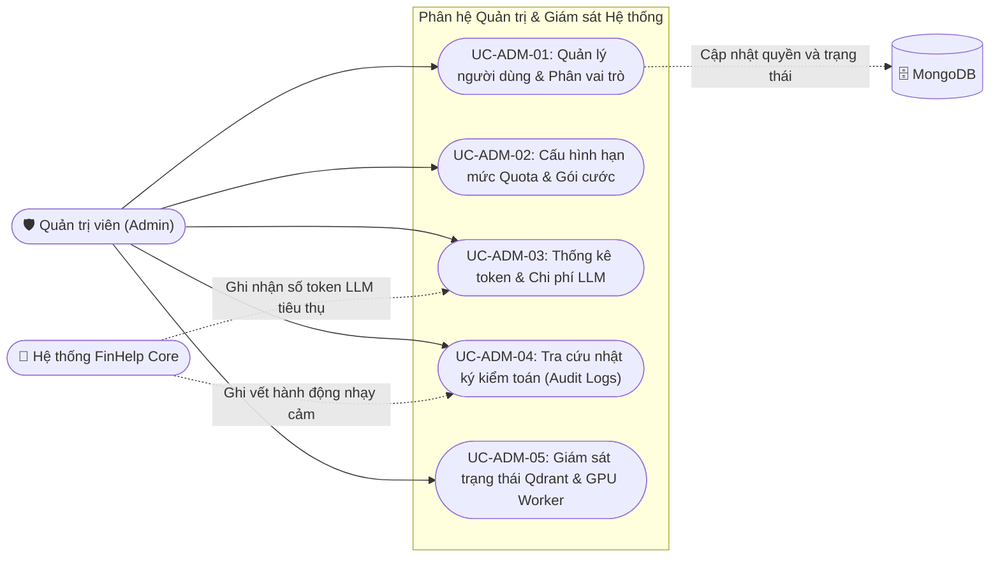
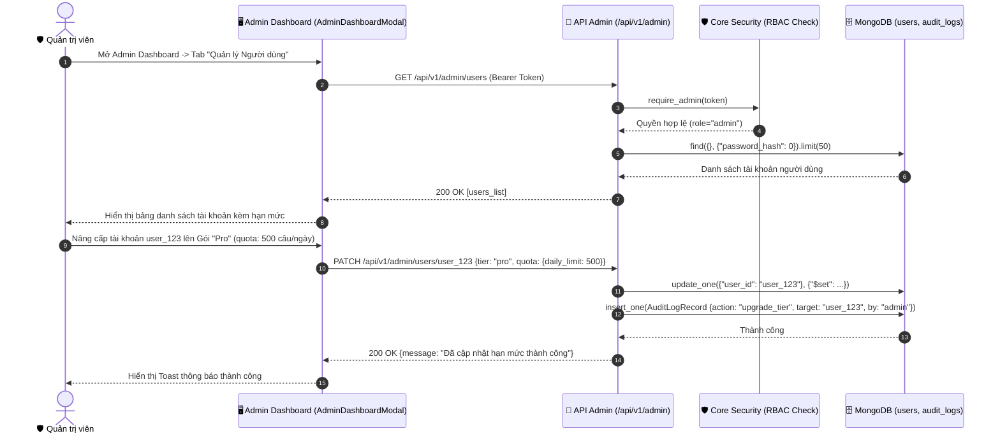

# Phân hệ 6: Quản trị Hệ thống & Giám sát (Admin & Monitoring Portal)

> **Mã phân hệ:** `MOD-ADMIN`  
> **Tác nhân tham gia:** `Admin` (Quản trị viên hệ thống), `System` (Hệ thống giám sát hạn mức & audit logs)

---

## 1. Biểu đồ Phân rã Use Case (Use Case Decomposition Diagram)

---

## 2. Bảng Đặc tả Chi tiết Các Use Case

### Bảng 2.1: Đặc tả Use Case "UC-ADM-01: Quản lý người dùng & Phân vai trò"

| Thuộc tính | Nội dung chi tiết |
|---|---|
| **Mã Use Case** | `UC-ADM-01` |
| **Tên Use Case** | Quản lý người dùng & Phân vai trò (User & Role Management) |
| **Tác nhân** | Quản trị viên (`Admin`), Hệ thống (`System`) |
| **Mô tả** | Quản trị viên tra cứu danh sách người dùng, kích hoạt hoặc tạm khóa tài khoản vi phạm, điều chỉnh vai trò (`admin`, `analyst`, `user`) và nâng cấp gói dịch vụ (`free`, `pro`, `enterprise`). |
| **Điều kiện tiên quyết** | Tài khoản thực hiện có vai trò `role = "admin"`. |
| **Điều kiện sau** | Trạng thái tài khoản được cập nhật trong bảng `users`, quyền hạn mới có hiệu lực ngay lập tức trong lần xác thực token tiếp theo. |
| **Luồng sự kiện chính (Main Flow)** | 1. Quản trị viên mở Admin Dashboard từ menu người dùng. 2. Hệ thống kiểm tra quyền Admin qua JWT Token (`GET /api/v1/auth/me`). 3. Admin Dashboard tải danh sách người dùng qua `GET /api/v1/admin/users`. 4. Quản trị viên tìm kiếm người dùng theo email hoặc tên đăng nhập. 5. Quản trị viên chọn thay đổi vai trò hoặc gói dịch vụ (ví dụ: cấp gói `pro` cho chuyên viên phân tích). 6. Frontend gửi yêu cầu `PATCH /api/v1/admin/users/{user_id}`. 7. Hệ thống cập nhật bảng `users` và ghi vết vào `audit_logs`. 8. Hiển thị thông báo cập nhật thành công. |
| **Luồng thay thế / Ngoại lệ** | **2a. Không đủ quyền Admin:** - Hệ thống từ chối truy cập với mã `HTTP 403 Forbidden`: *"Bạn không có quyền truy cập vào cổng quản trị"*. |

---

### Bảng 2.2: Đặc tả Use Case "UC-ADM-03: Thống kê token & Chi phí LLM"

| Thuộc tính | Nội dung chi tiết |
|---|---|
| **Mã Use Case** | `UC-ADM-03` |
| **Tên Use Case** | Thống kê token & Chi phí LLM (Token Usage & Cost Monitoring) |
| **Tác nhân** | Quản trị viên (`Admin`), Hệ thống (`System`) |
| **Mô tả** | Quản trị viên theo dõi tổng số lượng token đầu vào (prompt tokens), token đầu ra (completion tokens), số lượt truy vấn BCTC hàng ngày và ước tính chi phí API DeepSeek/OpenAI phát sinh để kiểm soát ngân sách. |
| **Điều kiện tiên quyết** | Tài khoản có quyền `admin`. |
| **Điều kiện sau** | Biểu đồ trực quan và bảng số liệu thống kê được hiển thị đầy đủ trên màn hình quản trị. |
| **Luồng sự kiện chính (Main Flow)** | 1. Quản trị viên chọn tab "Thống kê tài nguyên & Chi phí". 2. Frontend gọi `GET /api/v1/admin/stats` kèm bộ lọc thời gian (7 ngày qua, 30 ngày qua). 3. Hệ thống tổng hợp dữ liệu từ collection `messages` và các job bóc tách. 4. Hiển thị: Tổng số lượt hỏi, Số lượt phát hiện sai lệch số liệu bị chặn bởi `answer_check`, Tổng số token tiêu thụ, Chi phí ước tính theo USD/VND. 5. Admin có thể xuất báo cáo thống kê phục vụ nghiệm thu đề tài. |

---

## 3. Biểu đồ Tuần tự Luồng Quản trị Hạn mức (Sequence Diagram)

